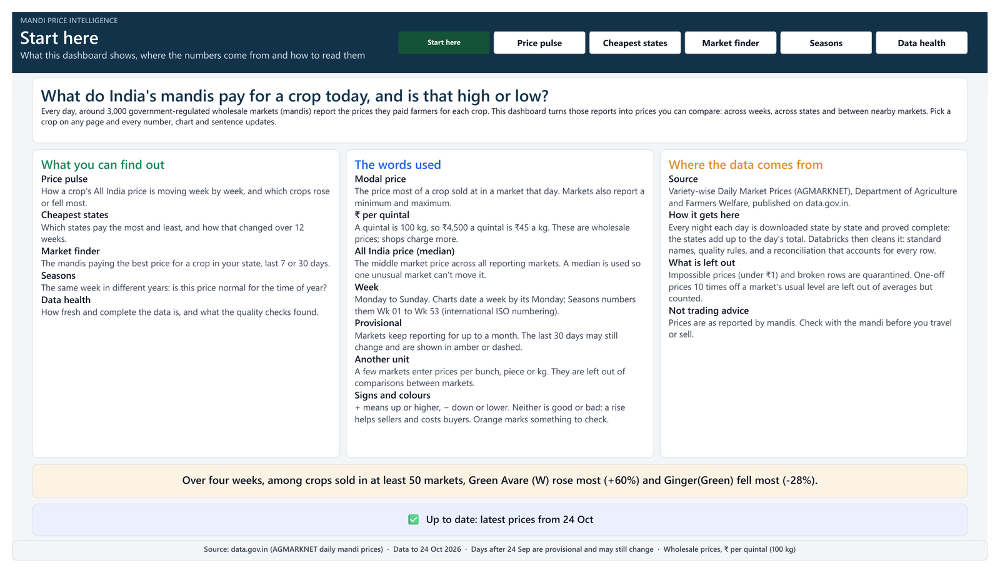
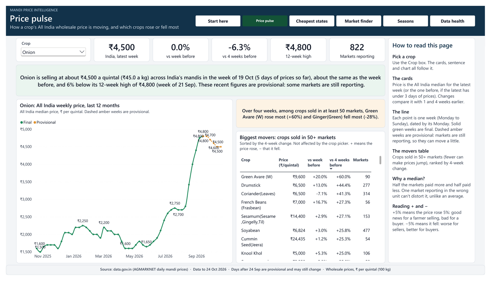
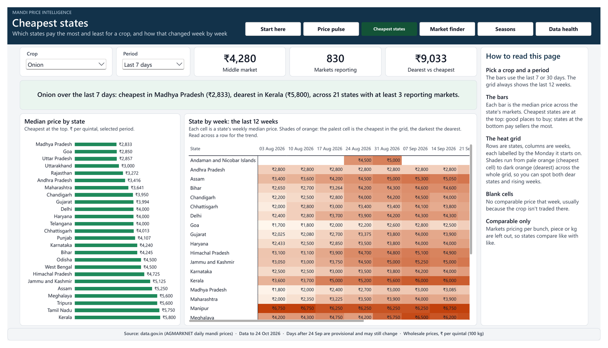
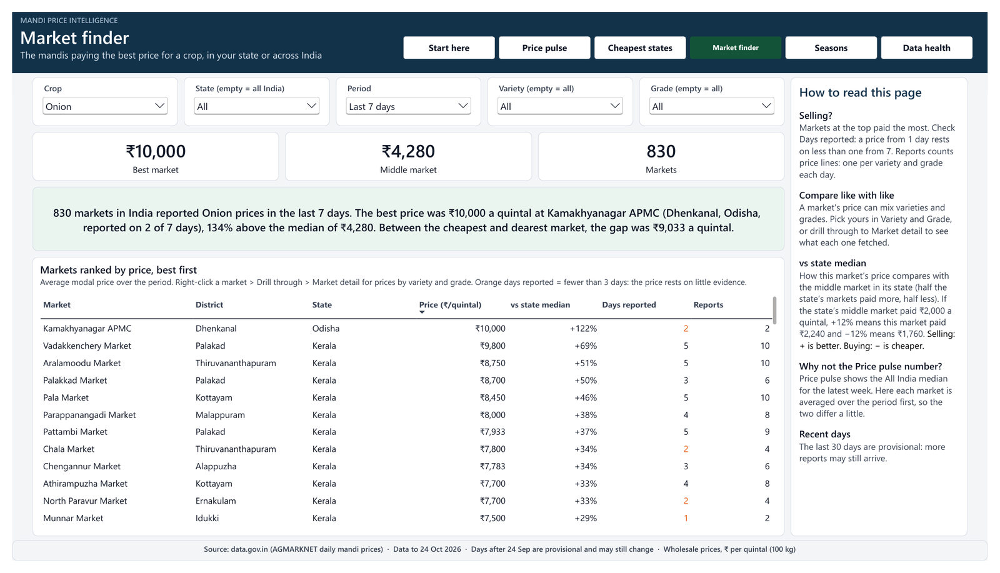
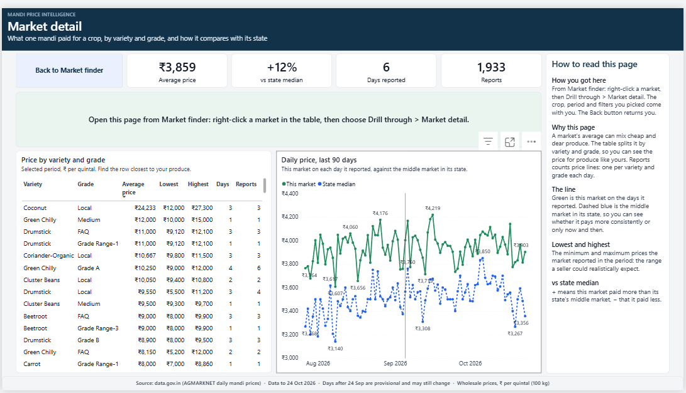
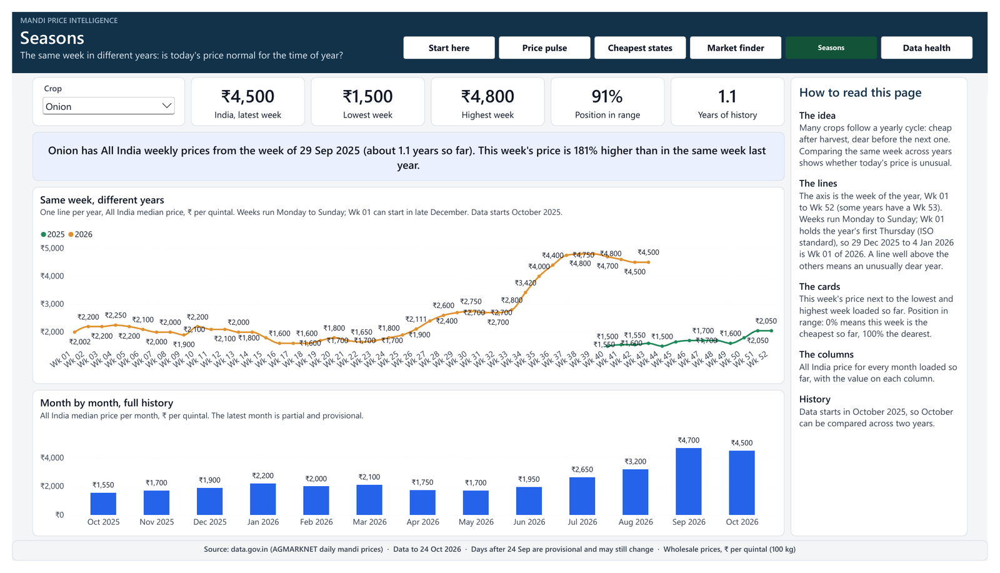
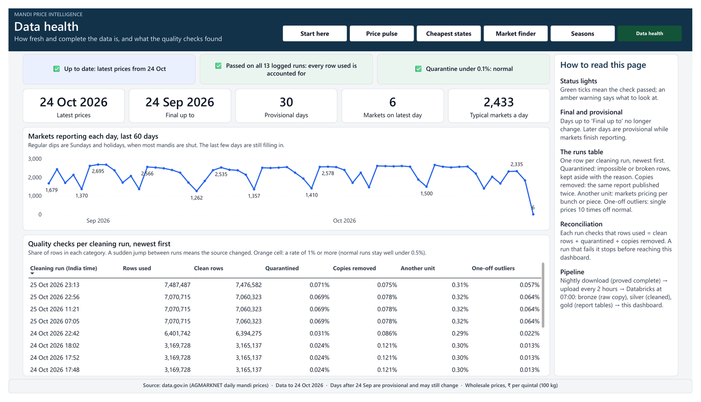

# Mandi Price Intelligence

An end-to-end data platform on **Databricks** that turns India's official daily mandi
(wholesale market) prices into trustworthy answers for farmers, traders and anyone
tracking food prices.

It builds a history of daily prices from data.gov.in (the start date is one setting), proves every day is
complete, and builds a **bronze → silver → gold** lakehouse with quality rules,
reconciliation at every step, and a daily automated job.

> **Status:** extraction, bronze, silver, gold, the daily Databricks job and the Power BI
> dashboard are built and verified on real data. Recent days are shown as provisional until
> final. Silver and gold rebuild only the months that change.


---

## Contents
1. [The problem](#the-problem)
2. [Questions it answers](#questions-it-answers)
3. [Project status](#project-status)
4. [The data](#the-data)
5. [How the pipeline works](#how-the-pipeline-works)
6. [The dashboard](#the-dashboard)
7. [What the data revealed](#what-the-data-revealed)
8. [Reliability: how every number is proved](#reliability-how-every-number-is-proved)
9. [Built for growing data](#built-for-growing-data)
10. [Engineering challenges solved](#engineering-challenges-solved)
11. [Concepts, tech stack and operations](#concepts-tech-stack-and-operations)
12. [Key design decisions](#key-design-decisions)
13. [Screenshots](#screenshots)
14. [Repository structure](#repository-structure)
15. [How to run it](#how-to-run-it)
16. [Roadmap](#roadmap)
17. [Lessons learned](#lessons-learned)
18. [Data source](#data-source)

**Deeper reading:** [design decisions](docs/decisions.md) ·
[data quality findings](docs/data_quality.md) · [incidents](docs/incidents/) ·
[design FAQ: every why, why not, when](docs/design_faq.md) · [daily job](jobs/README.md)

---

## The problem

The same crop can sell at very different prices in mandis a few hours apart, and most
sellers only know the price at the one they visit. Price spikes in staples such as onion
and tomato reach households before anyone flags them.

The data to see this is public, but hard to use: one raw row per market, crop and day
(thousands of rows a day), names spelled several ways, prices stored as text, late
uploads for weeks after the date, some markets entering prices per bunch or per piece
in a "per quintal" column, and an API that is slow, rate-limited and, as this project
found, silently loses rows when paged.

## Questions it answers

| Who | Question | Status |
| --- | --- | --- |
| Farmer or producer group | Which mandi near me paid best for my crop this week? | Answered: Market finder, with variety and grade, and a drillthrough per market |
| Trader or buyer | Is today's price high or low for this time of year? | Answered for the months covered twice; sharper with each added year |
| Household or journalist | Which staples are rising unusually fast? | Answered: Price pulse, biggest movers |
| Data team | Did today's load succeed, and is every day complete? | Built: checks, reconciliation, job alerts |

## Project status

| Phase | What | Status |
| --- | --- | --- |
| Extraction | History of daily prices from a fixed start date, provably complete, nightly | ✅ Built |
| Upload | Final days and provisional versions of recent days to Databricks, every 2 hours, each verified | ✅ Built |
| Bronze | Auto Loader into Delta, reconciled per file | ✅ Verified |
| Silver | Types, quality rules, quarantine, de-duplication, flags | ✅ Verified |
| Gold | Star schema, market-day fact, weekly and monthly prices | ✅ Verified |
| Incremental | Silver and gold rebuild only the months that changed | ✅ Proved by test, measured on real runs |
| Orchestration | Databricks job bronze → silver → gold, daily, alerts | ✅ Ran daily · schedules now paused (dataset final) |
| Recent days | Shown as provisional until final, so gold reaches yesterday | ✅ Verified |
| Reporting | Power BI report: 7 pages, drillthrough, self-writing summaries | ✅ Built · public tracker planned |
| CI | Tests on every push (GitHub Actions) | Planned |

## The data

| | |
| --- | --- |
| Dataset | *Variety-wise Daily Market Prices Data of Commodity* (AGMARKNET), via data.gov.in |
| Fields | State, District, Market, Commodity, Commodity code, Variety, Grade, Arrival date, Min, Max and Modal price (Rs per quintal) |
| Grain | One price report per market, crop, variety, grade and day; some markets report several times a day |
| Coverage | Every state; thousands of markets and hundreds of crops |
| History | From a fixed start date to yesterday, set by one option; extending it downloads only the added days ([decision 011](docs/decisions.md)) |
| Storage | Raw answers kept unchanged, gzip-compressed (about 10x smaller than plain JSON) |

## How the pipeline works

### 1. Extraction (laptop, nightly at 21:00) · [`mandi_pipeline/`](mandi_pipeline), [`backfill_history.py`](backfill_history.py)
- **Why a laptop:** data.gov.in refuses connections from cloud servers (tested from
  Google Colab and Databricks), so the download runs from a network in India.
- Each day is downloaded **one state per request**, 4 at a time. No paging: paging
  silently swapped real rows for duplicates (see [incident](docs/incidents/2026-10-23-pagination-overlap.md)).
- A day is marked complete only if **the states add up to the day's own total and no
  row appears twice**.
- **Check before download:** a day already complete on disk costs one small request;
  restarts never re-download finished days.
- The last **30 days are refreshed** (at most every 20 hours), because mandis keep
  uploading late: Tamil Nadu's 1 October grew 2.6% over three weeks.
- Raw answers are saved unchanged, gzip-compressed.

### 2. Upload (laptop, every 2 hours) · [`upload_to_databricks.py`](upload_to_databricks.py)
Runs as its own scheduled task, so a long download never holds back finished days.

| Kind | When | Where in the volume |
| --- | --- | --- |
| **Final** | Once, when a day is older than 30 days | `mandi_v2/arrival_date=D/commodity=ALL/` |
| **Provisional** | Each time a recent day's data changes and passes both checks | `mandi_v2_provisional/arrival_date=D/pulled_at=T/expected_rows=N/` |

Every file's size is verified after upload. A day being rewritten is never sent: the
downloader removes its "complete" marker first, and the uploader checks the files didn't
change during the upload. The row count in the folder name lets Databricks tell a fully
uploaded version from a partly uploaded one.

### 3. Bronze · [`notebooks/10_bronze_mandi_prices.py`](notebooks/10_bronze_mandi_prices.py)
- **Auto Loader** loads only files it hasn't seen (checkpoint), so reruns never duplicate.
- Every value kept **as text plus the original record JSON**: a change in the source's
  types can't break the load, and the raw record is always provable.
- Lineage columns: source file, file time, load time.
- Final days and provisional versions load into separate tables; superseded provisional
  versions, and those of days that became final, are removed after each load.
- **Reconciliation:** each file's rows must equal the API's total for that state, or the run fails.
- **Change Data Feed** on, and the final table **clustered by day**, so silver can read only what changed.

### 4. Silver · [`notebooks/20_silver_mandi_prices.py`](notebooks/20_silver_mandi_prices.py)

| Step | What |
| --- | --- |
| Final or provisional | Each day from its final data if it exists, otherwise its latest **complete** provisional version; marked `data_status` |
| Types | Dates as `dd/MM/yyyy`, prices as decimals (`try_cast`, so one bad value can't stop the run) |
| Standard names | State spellings mapped through a reference table (`Keralam` → `Kerala`, `Chattisgarh` → `Chhattisgarh`) |
| Quality rules | Failing rows go to **quarantine** with the reason, never silently dropped |
| Copies after cleaning | Reports identical once spaces are trimmed are kept once |
| Unit flag | A market's whole month for a crop 10x off the typical market |
| Outlier flag | One price 10x off its own market's usual price |
| **Reconciliation** | rows used from bronze = silver + quarantine + copies removed, or the run fails |

Each run appends its counts to `ops.silver_quality_log`, so quality is tracked over time.

**Incremental by month:** a run rebuilds only the months whose bronze data changed (see
[Built for growing data](#built-for-growing-data)); reconciliation still covers every month,
through a month-by-month ledger.

### 5. Gold · [`notebooks/30_gold_mandi_prices.py`](notebooks/30_gold_mandi_prices.py)

A **star schema** for Power BI:

| Table | Grain |
| --- | --- |
| `dim_market` | market (state, district, market) |
| `dim_commodity` | crop |
| `dim_date` | calendar day, covering the full history |
| `fact_market_day_price` | day × market × crop × variety × grade |
| `agg_price_weekly` / `agg_price_monthly` | period × crop × state, plus **All India** |

- Outliers are left out of prices but **counted**; unit-flagged series stay for their own
  market's trend and are left out of comparisons across markets.
- State and national prices are **medians** of market prices, so one bad market can't move them.
- Keys are `xxhash64` hashes of the names: the same on every rebuild.
- Every fact row carries `data_status`, and weekly and monthly rows count their
  `provisional_days`, so reports can mark figures that may still change.
- **Checks:** every silver report in the fact table, no key clashes, no duplicate grain,
  every fact linked to its dimensions. Any failure stops the run.
- **Incremental:** follows silver, replacing only the months it rebuilt (and every week touching them).

### 6. Orchestration · [`jobs/mandi_daily.yml`](jobs/mandi_daily.yml)
A Databricks job runs **bronze → silver → gold** daily at 07:00 IST on serverless
compute, fetching the notebooks from this repository on every run. Each task runs only if
the previous one succeeded, retries once after 5 minutes, and failures email an alert.

## The dashboard

Seven Power BI pages, each built around one question. Pick a crop on any page and every number,
chart and sentence updates; summaries are written by DAX, so they always describe the current data.
Built as a PBIP project in [`powerbi/`](powerbi): a star schema over the gold tables, with every measure documented.

| Page | The question it answers |
| --- | --- |
| **Start here** | What is this, where does the data come from, and what do the words mean? |
| **Price pulse** | How is a crop's All India price moving week by week, and which crops moved most? |
| **Cheapest states** | Which states pay the most and least, and how has that changed over 12 weeks? |
| **Market finder** | Which mandis pay the best price, in my state or across India, and how much evidence is behind it? |
| **Market detail** (drillthrough) | What did one mandi pay by variety and grade, and does it beat its state consistently? |
| **Seasons** | Is today's price normal for this time of year? |
| **Data health** | How fresh and complete is the data, and what did the quality checks find? |

| | |
| --- | --- |
|  |  |
|  |  |
|  |  |
|  | |

**Design choices that make it readable:** every page has a "How to read this page" panel; +/−
signs show direction without implying good or bad (a rise helps sellers and costs buyers);
recent, still-changing weeks are dashed and labelled provisional; weeks follow the ISO standard
(Wk 01 can start in late December), stated on the page; and orange is used only for "check this".

## What the data revealed

### What building it revealed about the source data

**1. Paging an unstable API loses data silently.** In the first download, 94 of 228 days
had real rows replaced by duplicates, and **every day's row count still matched**. Found
by profiling, proved by re-downloading, fixed by downloading state by state.
[Incident write-up](docs/incidents/2026-10-23-pagination-overlap.md)

**2. 2,830 "duplicates" were a trailing space.** Silver found copies that the downloader's
byte-level check didn't. Every pair differed only by a space in the market name
(`"APMC Kolhapur"` and `"APMC Kolhapur "`). 37 Maharashtra and Telangana markets are
published under both names; counting both would double their weight in every average.

**3. "Rs per quintal" isn't always per quintal.** The first outlier rule flagged 2,361
rows; measuring them disproved the obvious theory (rare crops: only 6%) and showed the
same markets flagged **every day**. Multiplying back revealed the real units:

| Market and crop | Price entered | Actual unit |
| --- | --- | --- |
| Pune markets: spinach, coriander, mint | Rs 3 to 9 | per bunch |
| Mapusa (Goa): coconut, pineapple | Rs 40, Rs 22 | per piece |
| Patti APMC (Punjab): tomato, potato | Rs 0.05 to 0.14 | not plausible in any unit → quarantined |

So one flag became two with different business meanings: **unit-suspect series** (valid
for their own trend, not for comparison) and **one-off outliers** (excluded). Outlier
flags fell from 2,361 to 45. [Details](docs/data_quality.md)

**4. The source changed in mid-2026.** Measured month by month, market names with stray
spaces went from 0% in May to 5.8% in August, and copies after cleaning jumped about 45
times in September. Trimming in silver kept each market's history continuous; without it,
"APMC Mumbai" would have become a new market mid-year. [Details](docs/data_quality.md)

### What the prices show

Findings as of October 2026, from the dashboard. Prices are All India wholesale medians,
₹ per quintal (100 kg), so ₹4,500 a quintal is ₹45 a kg at the mandi; shops charge more.

**1. Onion tripled in a year.** The monthly price
ran from ₹1,550 in October 2025 to ₹4,700 in September 2026. The low point was April to May
(₹1,700 to ₹1,750), when the winter-sown crop is harvested and stored onion floods the mandis;
the climb began in July, as stored stock ran down before the new crop arrived. The October
2026 price (₹4,500) is 190% above October 2025, so this is more than the usual seasonal
climb: the same month, a very different year.

| Month | Oct 25 | Dec | Feb | Apr | Jun | Aug | Sep | Oct 26 |
| --- | --- | --- | --- | --- | --- | --- | --- | --- |
| Onion | 1,550 | 1,900 | 2,000 | 1,750 | 1,950 | 3,200 | **4,700** | 4,500 |
| Tomato | 2,200 | **3,500** | 1,750 | 1,750 | 2,750 | 2,050 | 2,500 | 2,800 |
| Potato | 1,300 | 1,200 | 1,000 | 1,100 | 1,100 | 1,100 | 1,200 | 1,200 |
| Wheat | 2,511 | 2,500 | 2,437 | 2,400 | 2,400 | 2,541 | 2,600 | 2,600 |

**2. Perishables swing; staples barely move.** Ranking crops sold in 300+ markets by the gap
between their dearest and cheapest month:

| Most volatile | Dearest month ÷ cheapest | Steadiest | Dearest month ÷ cheapest |
| --- | --- | --- | --- |
| Lemon | 3.2× | Wheat | 1.13× |
| Onion | 3.0× | Pumpkin | 1.14× |
| Carrot | 2.6× | Bajra | 1.24× |
| Garlic | 2.5× | Bottle gourd | 1.28× |
| Ginger (green) | 2.5× | Potato | 1.46× |

Tomato peaked twice (December and June) and fell to ₹1,500 in March: a 2.3× swing within the year.
Potato stays within ±20%, likely because cold storage spreads the harvest across the year.

**3. Where you sell matters as much as when.** In the 7 days to 24 October 2026, onion's
middle price was ₹2,833 in Madhya Pradesh and ₹5,800 in Kerala, about twice as much, across
21 states with at least 3 reporting markets. Between single markets the gap is wider still:
830 markets reported onion in those 7 days, with a median of ₹4,280.

**4. The headline "best price" needs its evidence.** In the same 7 days the highest onion price,
₹10,000 at Kamakhyanagar APMC (Odisha), came from just 2 reports on 2 of 7 days. A market
almost as high, ₹9,800, had reported on 5 days. A farmer acting on the first could travel for a
price that was a one-off, so the dashboard's sentence now states the days behind every best
price, and markets with fewer than 3 days are marked in the table.

## Reliability: how every number is proved

| Stage | Check | On failure |
| --- | --- | --- |
| Download | States add up to the day's total **and** no duplicate rows | Day not marked complete; retried next run |
| Upload | File sizes verified; completion marker last | Day not marked uploaded |
| Bronze | Rows per file = API total for that state | Run fails |
| Silver | bronze = silver + quarantine + copies removed | Run fails |
| Gold | All silver reports in fact; keys unique; grain unique; dimensions linked | Run fails |
| Job | Each layer runs only if the previous passed | Email alert; dashboard keeps yesterday's correct data |

Every step is **idempotent** (safe to rerun) and **resumable**. 35 automated tests
reproduce failures met against the real API.

## Built for growing data

Every day adds data, and the history can be extended at any time. Each layer is built so that daily work depends
on **what changed**, not on how much history exists.

| Layer | Technique | What it saves |
| --- | --- | --- |
| Laptop | Download and upload only missing or changed days | History is never fetched twice |
| Bronze | Auto Loader with checkpoints | Each run loads only new files |
| Bronze | **Change Data Feed** | Silver asks "what changed since version N?" instead of re-reading bronze |
| All layers | **Liquid clustering** by date | Reading one month opens only that month's files |
| Silver, gold | **Rebuild only changed months**, swapped in one transaction (`replaceWhere`) | A daily run touches one or two months, whatever the length of the history |
| Gold | Weekly and monthly tables built with `GROUPING SETS` | Trend queries read tables tens of times smaller than the daily fact |
| Power BI | Star schema, integer keys, daily rows for the last 15 months, trends from aggregates | The model stays small and quick to refresh |

**Why months, not days?** Silver's unit and outlier flags compare a price with its market's
**monthly** median, so one new day can change every flag in its month. The month is the
smallest unit that can be rebuilt on its own and give exactly the result of a full rebuild.

**Safety switches**
- A **fingerprint of the rules** (rule SQL and state mapping) is compared with the last run's.
  Change a rule and the next run rebuilds every month automatically, so old and new months
  never follow different rules. Gold does the same for its own logic.
- Full rebuild on the first run, on request (`mode = full`), or if the change feed can't be read.
- State is saved only after a run succeeds; replacing a month twice gives the same result.

**Proved, not assumed.** [`tests/local_incremental_test.py`](tests/local_incremental_test.py)
runs the real notebooks on local Spark: a full build, new data arriving (days turning final, a new
provisional version, an incomplete one, a backfilled older month), an incremental run, then a
fresh full rebuild of the same bronze. **All eight output tables match row for row.** It also
checks that an unchanged bronze skips, and that a rules change forces a full rebuild.

**Measured on every run.** `ops.pipeline_runs` records each run's mode, reason, months, rows read
and written, and seconds, so the saving is visible in the data rather than claimed.

**Measured on real data.** Two back-to-back runs on the same history:

| Run | Why it ran | Months rebuilt | Rows read | Silver time | Gold time |
| --- | --- | --- | --- | --- | --- |
| Full rebuild | a cleaning rule changed (a new spelling of a state) | all | 100% | 100% | 100% |
| Incremental | newly arrived days | 3 | **18%** | **53%** | **61%** |

Rows read fall in line with the months touched. Time falls less, because every run has a fixed
cost of about half a minute (reading the change feed, the reconciliation checks, compute start-up).
As the history grows, a full rebuild keeps getting slower while a normal day's run stays about the
same, so the gap keeps widening. Exact figures: [decision 010](docs/decisions.md).

## Engineering challenges solved

| Challenge | What happened | Fix | Write-up |
| --- | --- | --- | --- |
| API ignored Python | Every Python request timed out; browsers worked | Browser-style User-Agent naming the project | [incident](docs/incidents/2026-10-22-datagov-python-timeouts.md) |
| Cloud blocked | Colab and Databricks couldn't reach data.gov.in | Extract in India, upload to Databricks | [decision 001](docs/decisions.md) |
| Silent loss from paging | Counts matched; duplicates replaced real rows on 94 days | State-by-state download, two checks | [incident](docs/incidents/2026-10-23-pagination-overlap.md) |
| Empty "ok" answers | Two states returned 0 rows with status ok | Sum check catches it; targeted retry | same incident |
| Slow and stuck requests | One page took 12.5 minutes; internet drops | Total time limit per request; waits out outages | [`api.py`](mandi_pipeline/api.py) |
| Wrong secret saved | Databricks token saved as the API key | Setup scripts validate each secret | [incident](docs/incidents/2026-10-23-wrong-secret-saved.md) |
| Restarts re-downloaded | Stopping meant starting again | Check before download against the API total | [decision 006](docs/decisions.md) |
| Mixed units in one column | Per-bunch prices looked like outliers | Series-level unit flag | [data quality](docs/data_quality.md) |
| Finished days stuck on the laptop | During the backfill the download ran for days, so the upload after it never started | Upload as its own task every 2 hours | [decision 009](docs/decisions.md) |
| Recent days a month late | Days were held back until final | Provisional versions, marked as such | [decision 009](docs/decisions.md) |
| Daily cost growing with history | Silver and gold reprocessed all history every morning | Rebuild only changed months, via Change Data Feed; proved equal to a full rebuild | [decision 010](docs/decisions.md) |

## Concepts, tech stack and operations

### Tech stack

| Area | Tools |
| --- | --- |
| Extraction | Python 3.12, `requests`, thread pool for parallel requests, gzip |
| Laptop automation | Windows Task Scheduler, PowerShell |
| Platform | Databricks Free Edition: Unity Catalog, volumes, Auto Loader, Delta Lake, serverless compute, Jobs |
| Transformation | Spark SQL, PySpark |
| Code and tests | Git, GitHub, pytest, Databricks Git folders |
| Reporting | Power BI Desktop, project format (TMDL model, PBIR report), DAX, Tabular Editor 2 |

### Concepts applied

| Area | Concepts |
| --- | --- |
| Architecture | Medallion (bronze, silver, gold), lakehouse, separation of extraction and processing |
| Ingestion | Incremental loading, checkpoints, schema-on-read, raw data kept unchanged, late-arriving data, day-level snapshot CDC, provisional and final data |
| Data quality | Profiling before rules, quarantine with reasons, reconciliation, robust outlier detection (median), reference tables for names |
| Modelling | Grain decisions, star schema, hash keys, pre-aggregated tables, `GROUPING SETS` for state and national totals |
| Performance | Incremental processing by month, Change Data Feed, atomic partial overwrite (`replaceWhere`), liquid clustering, data skipping, pre-aggregated tables, compressed raw files |
| Reliability | Idempotency, retries with backoff, rate-limit handling, timeouts, fail fast, file locks, completion markers |
| Security | Secrets outside code, least-privilege tokens, key redaction in logs, rotation after exposure, public-repo hygiene |
| Engineering practice | Decision log, incident write-ups, tests reproducing real failures, Git workflow without force-pushing |

### Operations: what runs where

| When | Where | What |
| --- | --- | --- |
| 21:00 daily | Laptop (Task Scheduler) | Download missing days and refresh the last 30; log to `logs/` |
| Every 2 hours | Laptop (Task Scheduler) | Upload final days and new provisional versions; log to `logs/` |
| Any time | Laptop | `status.ps1`: progress, gaps, failed days, last run result |
| 07:00 daily | Databricks job `mandi_daily` | Bronze → silver → gold with checks |
| On failure | Email | Which task failed; repair from the failed task |

**Schedules are paused** now that the dataset is final for this project. Everything above is
built and was run daily; turning it back on is one switch each: `Enable-ScheduledTask` on the laptop,
and `pause_status: UNPAUSED` in [`jobs/mandi_daily.yml`](jobs/mandi_daily.yml) (or Resume in the job's schedule).

## Key design decisions

Full reasoning and alternatives in [`docs/decisions.md`](docs/decisions.md).

1. Extract from a computer in India, not the cloud
2. Browser-style User-Agent that names the project
3. Multi-year history, stored as compressed raw files
4. One-time backfill plus a rolling daily update
5. Download one state per request, not in pages
6. A day is complete only when two independent checks pass
7. Two price flags: unit-suspect series and one-off outliers
8. Gold as a star schema; national prices as medians of market prices
9. Recent days shown as provisional; upload separate from download
10. Silver and gold rebuild only the months that changed
11. History from a fixed start date, extendable with one setting

## Screenshots

| | |
| --- | --- |
| **Daily job: bronze → silver → gold** |  |
| **Unity Catalog: catalog, schemas, tables** |  |
| **Silver reconciliation** |  |
| **Unit-suspect series** (per bunch, per piece) |  |
| **Gold checks** |  |
| **All India weekly prices** |  |
| **Laptop status report** |  |

## Repository structure

```
mandi_pipeline/            extraction code: api.py (requests, retries), download.py (one day)
backfill_history.py        download command (backfill and daily)
upload_to_databricks.py    upload final days and provisional versions to Databricks
daily_run.ps1              runs the download or upload step, with logs
setup_scheduled_task.ps1   one-time: save the API key, create the download and upload tasks
setup_databricks_token.ps1 one-time: save and test the Databricks token
status.ps1 / status.py     progress, gaps, failures, last run
notebooks/                 Databricks: 10 bronze, 20 silver, 30 gold; incremental.py (shared helpers)
jobs/                      Databricks job definition (YAML) and notes
tests/                     pytest: 35 tests; local_incremental_test.py (Spark: incremental = full rebuild)
tools/                     diagnostics: compare downloads, test User-Agent, pull a sample
docs/
  decisions.md             design decisions and alternatives
  data_quality.md          profiling results and quality rules
  design_faq.md            every why, why not and when, in Q&A form
  incidents/               what went wrong, root cause, fix, lessons
  images/                  architecture and screenshots
```

## How to run it

**Prerequisites:** Windows with Python 3.12+, Git and the Databricks CLI; a data.gov.in API
key; a Databricks workspace (Free Edition works) with catalog `mandi_dev`, schemas
`bronze`, `silver`, `gold`, `ops`, and volumes `bronze.raw_files` and `bronze.checkpoints`.

**Laptop, once:**
```powershell
python -m pip install -r requirements.txt
powershell -ExecutionPolicy Bypass -File .\setup_databricks_token.ps1   # Databricks token, tested
powershell -ExecutionPolicy Bypass -File .\setup_scheduled_task.ps1     # API key + nightly task
```

**Databricks, once:** create a Git folder from this repository, then create the job from
[`jobs/mandi_daily.yml`](jobs/README.md).

**Daily:** automatic. Check the laptop with `.\status.ps1`; check Databricks in the job's run history.

**Tests:** `python -m pytest -v`. The Spark test needs PySpark and Java:
`python tests/local_incremental_test.py`

## Roadmap

- [x] Extraction with completeness checks, retries and resume
- [x] Nightly laptop automation, status report
- [x] Bronze with Auto Loader and reconciliation
- [x] Silver: quality rules, quarantine, de-duplication, unit and outlier flags
- [x] Gold: star schema, market-day fact, weekly and monthly prices
- [x] Daily Databricks job with alerts
- [x] Recent days as provisional data, so gold reaches yesterday
- [x] Incremental silver and gold by month, proved equal to a full rebuild
- [x] History for the chosen window downloaded (extendable)
- [x] Power BI report with drillthrough
- [ ] Public price tracker
- [ ] Price signals: best nearby mandi, unusual rises, prices below MSP
- [ ] CI: tests on every push

## Lessons learned

- **Matching counts don't prove completeness.** Duplicates exposed missing rows that a
  count check could never see.
- **Never trust "status: ok".** Check that the parts add up to the whole.
- **Measure before changing a rule.** The obvious explanation for the outliers was wrong;
  the measurement found mixed units.
- **Two checks can disagree and both be right.** Byte-level and business-level duplicates
  answer different questions; the gap was worth investigating.
- **Flag, don't invent.** Per-bunch prices can't be converted without knowing a bunch's
  weight, so they are labelled, not "fixed".
- **Fix the process, not the symptom.** Repeated mistakes became validation in scripts.

## Data source

*Variety-wise Daily Market Prices Data of Commodity*, Directorate of Marketing and
Inspection, Department of Agriculture and Farmers Welfare, Government of India, published
on the [Open Government Data Platform India](https://data.gov.in) (sourced from AGMARKNET).
Prices are as reported by mandis and are not trading advice.

Author: **Vikash Mishra** · [GitHub](https://github.com/vm8181)
