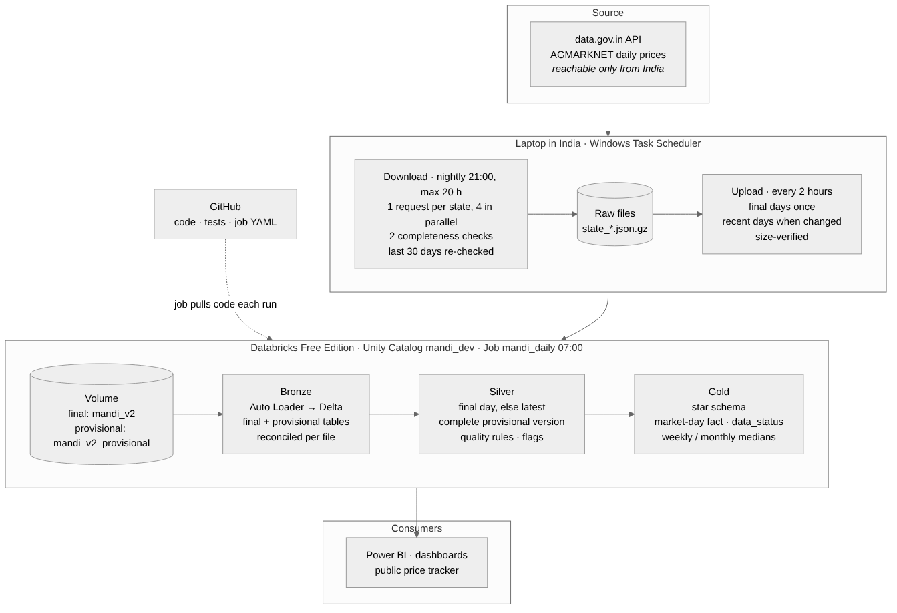
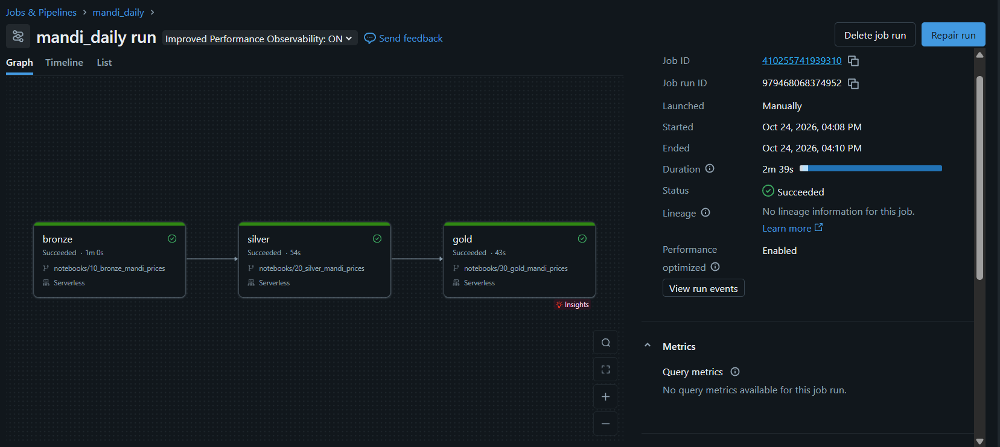
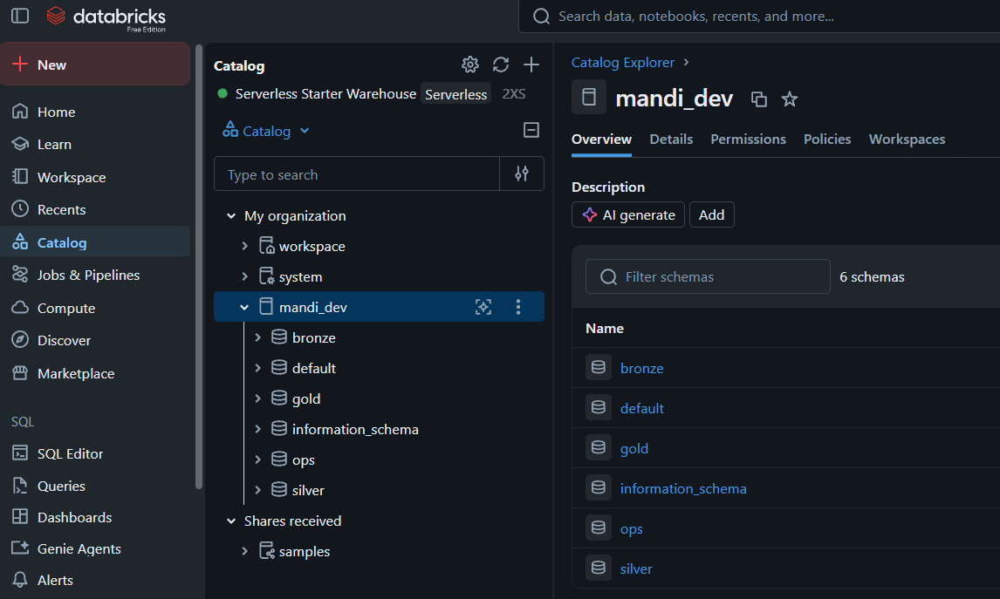
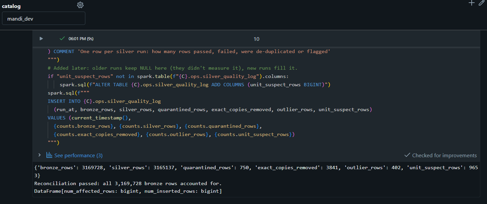
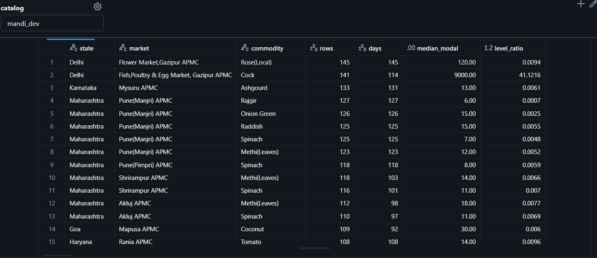
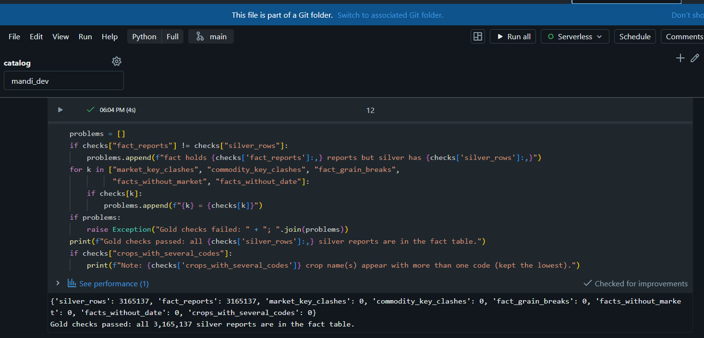
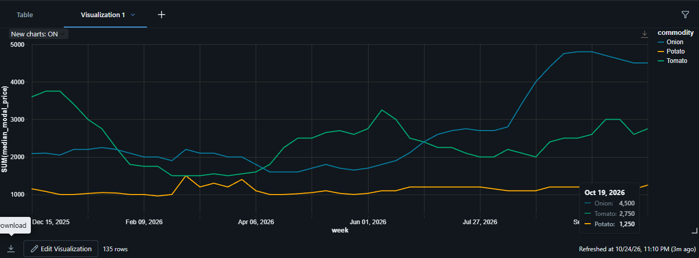
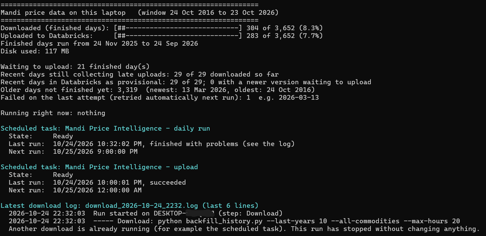

# Mandi Price Intelligence

An end-to-end data platform on **Databricks** that turns India's official daily mandi
(wholesale market) prices into trustworthy answers for farmers, traders and anyone
tracking food prices.

It builds a multi-year history of daily prices from data.gov.in, proves every day is
complete, and builds a **bronze → silver → gold** lakehouse with quality rules,
reconciliation at every step, and a daily automated job.

> **Status:** extraction, bronze, silver, gold and the daily Databricks job are built and
> verified on real data. Recent days are shown as provisional until final. The historical
> backfill is downloading. Next: the Power BI dashboard.



---

## Contents
1. [The problem](#the-problem)
2. [Questions it answers](#questions-it-answers)
3. [Project status](#project-status)
4. [The data](#the-data)
5. [How the pipeline works](#how-the-pipeline-works)
6. [What the data revealed](#what-the-data-revealed)
7. [Reliability: how every number is proved](#reliability-how-every-number-is-proved)
8. [Engineering challenges solved](#engineering-challenges-solved)
9. [Concepts, tech stack and operations](#concepts-tech-stack-and-operations)
10. [Key design decisions](#key-design-decisions)
11. [Screenshots](#screenshots)
12. [Repository structure](#repository-structure)
13. [How to run it](#how-to-run-it)
14. [Roadmap](#roadmap)
15. [Lessons learned](#lessons-learned)
16. [Data source](#data-source)

**Deeper reading:** [design decisions](docs/decisions.md) ·
[data quality findings](docs/data_quality.md) · [incidents](docs/incidents/) ·
[design FAQ: every why, why not, when](docs/design_faq.md) · [daily job](jobs/README.md)

---

## The problem

The same crop can sell at very different prices in mandis a few hours apart, and most
sellers only know the price at the one they visit. Price spikes in staples such as onion
and tomato reach households before anyone flags them.

The data to see this is public, but hard to use: one raw row per market, crop and day
(thousands of rows a day), names spelled several ways, prices stored as text, late
uploads for weeks after the date, some markets entering prices per bunch or per piece
in a "per quintal" column, and an API that is slow, rate-limited and, as this project
found, silently loses rows when paged.

## Questions it answers

| Who | Question | Status |
| --- | --- | --- |
| Farmer or producer group | Which mandi near me paid best for my crop this week? | Gold data ready; dashboard next |
| Trader or buyer | Is today's price high or low for this time of year? | Needs the historical backfill (downloading) |
| Household or journalist | Which staples are rising unusually fast? | First weekly trend built (below) |
| Data team | Did today's load succeed, and is every day complete? | Built: checks, reconciliation, job alerts |

## Project status

| Phase | What | Status |
| --- | --- | --- |
| Extraction | Multi-year history of daily prices, provably complete, nightly | ✅ Built · backfill running |
| Upload | Final days and provisional versions of recent days to Databricks, every 2 hours, each verified | ✅ Built |
| Bronze | Auto Loader into Delta, reconciled per file | ✅ Verified |
| Silver | Types, quality rules, quarantine, de-duplication, flags | ✅ Verified |
| Gold | Star schema, market-day fact, weekly and monthly prices | ✅ Verified |
| Orchestration | Databricks job bronze → silver → gold, daily, alerts | ✅ Running daily at 07:00 IST |
| Recent days | Shown as provisional until final, so gold reaches yesterday | ✅ Built · first run pending |
| Reporting | Power BI report, public price tracker | Planned |
| CI | Tests on every push (GitHub Actions) | Planned |

## The data

| | |
| --- | --- |
| Dataset | *Variety-wise Daily Market Prices Data of Commodity* (AGMARKNET), via data.gov.in |
| Fields | State, District, Market, Commodity, Commodity code, Variety, Grade, Arrival date, Min, Max and Modal price (Rs per quintal) |
| Grain | One price report per market, crop, variety, grade and day; some markets report several times a day |
| Coverage | Every state; thousands of markets and hundreds of crops |
| History | A rolling multi-year window up to yesterday, set by one command-line option |
| Storage | Raw answers kept unchanged, gzip-compressed (about 10x smaller than plain JSON) |

## How the pipeline works

### 1. Extraction (laptop, nightly at 21:00) · [`mandi_pipeline/`](mandi_pipeline), [`backfill_history.py`](backfill_history.py)
- **Why a laptop:** data.gov.in refuses connections from cloud servers (tested from
  Google Colab and Databricks), so the download runs from a network in India.
- Each day is downloaded **one state per request**, 4 at a time. No paging: paging
  silently swapped real rows for duplicates (see [incident](docs/incidents/2026-10-23-pagination-overlap.md)).
- A day is marked complete only if **the states add up to the day's own total and no
  row appears twice**.
- **Check before download:** a day already complete on disk costs one small request;
  restarts never re-download finished days.
- The last **30 days are refreshed** (at most every 20 hours), because mandis keep
  uploading late: Tamil Nadu's 1 October grew 2.6% over three weeks.
- Raw answers are saved unchanged, gzip-compressed.

### 2. Upload (laptop, every 2 hours) · [`upload_to_databricks.py`](upload_to_databricks.py)
Runs as its own scheduled task, so a long download never holds back finished days.

| Kind | When | Where in the volume |
| --- | --- | --- |
| **Final** | Once, when a day is older than 30 days | `mandi_v2/arrival_date=D/commodity=ALL/` |
| **Provisional** | Each time a recent day's data changes and passes both checks | `mandi_v2_provisional/arrival_date=D/pulled_at=T/expected_rows=N/` |

Every file's size is verified after upload. A day being rewritten is never sent: the
downloader removes its "complete" marker first, and the uploader checks the files didn't
change during the upload. The row count in the folder name lets Databricks tell a fully
uploaded version from a partly uploaded one.

### 3. Bronze · [`notebooks/10_bronze_mandi_prices.py`](notebooks/10_bronze_mandi_prices.py)
- **Auto Loader** loads only files it hasn't seen (checkpoint), so reruns never duplicate.
- Every value kept **as text plus the original record JSON**: a change in the source's
  types can't break the load, and the raw record is always provable.
- Lineage columns: source file, file time, load time.
- Final days and provisional versions load into separate tables; superseded provisional
  versions, and those of days that became final, are removed after each load.
- **Reconciliation:** each file's rows must equal the API's total for that state, or the run fails.

### 4. Silver · [`notebooks/20_silver_mandi_prices.py`](notebooks/20_silver_mandi_prices.py)

| Step | What |
| --- | --- |
| Final or provisional | Each day from its final data if it exists, otherwise its latest **complete** provisional version; marked `data_status` |
| Types | Dates as `dd/MM/yyyy`, prices as decimals (`try_cast`, so one bad value can't stop the run) |
| Standard names | State spellings mapped through a reference table (`Keralam` → `Kerala`, `Chattisgarh` → `Chhattisgarh`) |
| Quality rules | Failing rows go to **quarantine** with the reason, never silently dropped |
| Copies after cleaning | Reports identical once spaces are trimmed are kept once |
| Unit flag | A market's whole month for a crop 10x off the typical market |
| Outlier flag | One price 10x off its own market's usual price |
| **Reconciliation** | rows used from bronze = silver + quarantine + copies removed, or the run fails |

Each run appends its counts to `ops.silver_quality_log`, so quality is tracked over time.

### 5. Gold · [`notebooks/30_gold_mandi_prices.py`](notebooks/30_gold_mandi_prices.py)

A **star schema** for Power BI:

| Table | Grain |
| --- | --- |
| `dim_market` | market (state, district, market) |
| `dim_commodity` | crop |
| `dim_date` | calendar day, covering the full history |
| `fact_market_day_price` | day × market × crop × variety × grade |
| `agg_price_weekly` / `agg_price_monthly` | period × crop × state, plus **All India** |

- Outliers are left out of prices but **counted**; unit-flagged series stay for their own
  market's trend and are left out of comparisons across markets.
- State and national prices are **medians** of market prices, so one bad market can't move them.
- Keys are `xxhash64` hashes of the names: the same on every rebuild.
- Every fact row carries `data_status`, and weekly and monthly rows count their
  `provisional_days`, so reports can mark figures that may still change.
- **Checks:** every silver report in the fact table, no key clashes, no duplicate grain,
  every fact linked to its dimensions. Any failure stops the run.

### 6. Orchestration · [`jobs/mandi_daily.yml`](jobs/mandi_daily.yml)
A Databricks job runs **bronze → silver → gold** daily at 07:00 IST on serverless
compute, fetching the notebooks from this repository on every run. Each task runs only if
the previous one succeeded, retries once after 5 minutes, and failures email an alert.

## What the data revealed

Findings from the first verification runs (April to September 2026 data).

**1. Paging an unstable API loses data silently.** In the first download, 94 of 228 days
had real rows replaced by duplicates, and **every day's row count still matched**. Found
by profiling, proved by re-downloading, fixed by downloading state by state.
[Incident write-up](docs/incidents/2026-10-23-pagination-overlap.md)

**2. 2,830 "duplicates" were a trailing space.** Silver found copies that the downloader's
byte-level check didn't. Every pair differed only by a space in the market name
(`"APMC Kolhapur"` and `"APMC Kolhapur "`). 37 Maharashtra and Telangana markets are
published under both names; counting both would double their weight in every average.

**3. "Rs per quintal" isn't always per quintal.** The first outlier rule flagged 2,361
rows; measuring them disproved the obvious theory (rare crops: only 6%) and showed the
same markets flagged **every day**. Multiplying back revealed the real units:

| Market and crop | Price entered | Actual unit |
| --- | --- | --- |
| Pune markets: spinach, coriander, mint | Rs 3 to 9 | per bunch |
| Mapusa (Goa): coconut, pineapple | Rs 40, Rs 22 | per piece |
| Patti APMC (Punjab): tomato, potato | Rs 0.05 to 0.14 | not plausible in any unit → quarantined |

So one flag became two with different business meanings: **unit-suspect series** (valid
for their own trend, not for comparison) and **one-off outliers** (excluded). Outlier
flags fell from 2,361 to 45. [Details](docs/data_quality.md)

**4. The source changed in mid-2026.** Measured month by month, market names with stray
spaces went from 0% in May to 5.8% in August, and copies after cleaning jumped about 45
times in September. Trimming in silver kept each market's history continuous; without it,
"APMC Mumbai" would have become a new market mid-year. [Details](docs/data_quality.md)

**5. First trend: All India wholesale prices, late Aug to Sep 2026** (median of about
1,000 markets each week)

| Crop | Week of 31 Aug | Week of 14 Sep | |
| --- | --- | --- | --- |
| Onion | Rs 4,400/quintal (Rs 44/kg) | Rs 4,800 (Rs 48/kg) | +9% in two weeks |
| Tomato | Rs 2,400 | Rs 2,500 | +4% |
| Potato | Rs 1,200 | Rs 1,200 | stable |

Wholesale, not retail. The full history will show whether this is the usual seasonal rise.

## Reliability: how every number is proved

| Stage | Check | On failure |
| --- | --- | --- |
| Download | States add up to the day's total **and** no duplicate rows | Day not marked complete; retried next run |
| Upload | File sizes verified; completion marker last | Day not marked uploaded |
| Bronze | Rows per file = API total for that state | Run fails |
| Silver | bronze = silver + quarantine + copies removed | Run fails |
| Gold | All silver reports in fact; keys unique; grain unique; dimensions linked | Run fails |
| Job | Each layer runs only if the previous passed | Email alert; dashboard keeps yesterday's correct data |

Every step is **idempotent** (safe to rerun) and **resumable**. 34 automated tests
reproduce failures met against the real API.

## Engineering challenges solved

| Challenge | What happened | Fix | Write-up |
| --- | --- | --- | --- |
| API ignored Python | Every Python request timed out; browsers worked | Browser-style User-Agent naming the project | [incident](docs/incidents/2026-10-22-datagov-python-timeouts.md) |
| Cloud blocked | Colab and Databricks couldn't reach data.gov.in | Extract in India, upload to Databricks | [decision 001](docs/decisions.md) |
| Silent loss from paging | Counts matched; duplicates replaced real rows on 94 days | State-by-state download, two checks | [incident](docs/incidents/2026-10-23-pagination-overlap.md) |
| Empty "ok" answers | Two states returned 0 rows with status ok | Sum check catches it; targeted retry | same incident |
| Slow and stuck requests | One page took 12.5 minutes; internet drops | Total time limit per request; waits out outages | [`api.py`](mandi_pipeline/api.py) |
| Wrong secret saved | Databricks token saved as the API key | Setup scripts validate each secret | [incident](docs/incidents/2026-10-23-wrong-secret-saved.md) |
| Restarts re-downloaded | Stopping meant starting again | Check before download against the API total | [decision 006](docs/decisions.md) |
| Mixed units in one column | Per-bunch prices looked like outliers | Series-level unit flag | [data quality](docs/data_quality.md) |
| Finished days stuck on the laptop | During the backfill the download ran for days, so the upload after it never started | Upload as its own task every 2 hours | [decision 009](docs/decisions.md) |
| Recent days a month late | Days were held back until final | Provisional versions, marked as such | [decision 009](docs/decisions.md) |

## Concepts, tech stack and operations

### Tech stack

| Area | Tools |
| --- | --- |
| Extraction | Python 3.12, `requests`, thread pool for parallel requests, gzip |
| Laptop automation | Windows Task Scheduler, PowerShell |
| Platform | Databricks Free Edition: Unity Catalog, volumes, Auto Loader, Delta Lake, serverless compute, Jobs |
| Transformation | Spark SQL, PySpark |
| Code and tests | Git, GitHub, pytest, Databricks Git folders |
| Reporting | Power BI *(next)* |

### Concepts applied

| Area | Concepts |
| --- | --- |
| Architecture | Medallion (bronze, silver, gold), lakehouse, separation of extraction and processing |
| Ingestion | Incremental loading, checkpoints, schema-on-read, raw data kept unchanged, late-arriving data, day-level snapshot CDC, provisional and final data |
| Data quality | Profiling before rules, quarantine with reasons, reconciliation, robust outlier detection (median), reference tables for names |
| Modelling | Grain decisions, star schema, hash keys, pre-aggregated tables, `GROUPING SETS` for state and national totals |
| Performance | Liquid clustering, compressed raw files, full rebuild now with incremental as a measured next step |
| Reliability | Idempotency, retries with backoff, rate-limit handling, timeouts, fail fast, file locks, completion markers |
| Security | Secrets outside code, least-privilege tokens, key redaction in logs, rotation after exposure, public-repo hygiene |
| Engineering practice | Decision log, incident write-ups, tests reproducing real failures, Git workflow without force-pushing |

### Operations: what runs where

| When | Where | What |
| --- | --- | --- |
| 21:00 daily | Laptop (Task Scheduler) | Download missing days and refresh the last 30; log to `logs/` |
| Every 2 hours | Laptop (Task Scheduler) | Upload final days and new provisional versions; log to `logs/` |
| Any time | Laptop | `status.ps1`: progress, gaps, failed days, last run result |
| 07:00 daily | Databricks job `mandi_daily` | Bronze → silver → gold with checks |
| On failure | Email | Which task failed; repair from the failed task |

## Key design decisions

Full reasoning and alternatives in [`docs/decisions.md`](docs/decisions.md).

1. Extract from a computer in India, not the cloud
2. Browser-style User-Agent that names the project
3. Multi-year history, stored as compressed raw files
4. One-time backfill plus a rolling daily update
5. Download one state per request, not in pages
6. A day is complete only when two independent checks pass
7. Two price flags: unit-suspect series and one-off outliers
8. Gold as a star schema; national prices as medians of market prices
9. Recent days shown as provisional; upload separate from download

## Screenshots

| | |
| --- | --- |
| **Daily job: bronze → silver → gold** |  |
| **Unity Catalog: catalog, schemas, tables** |  |
| **Silver reconciliation** |  |
| **Unit-suspect series** (per bunch, per piece) |  |
| **Gold checks** |  |
| **All India weekly prices** |  |
| **Laptop status report** |  |

## Repository structure

```
mandi_pipeline/            extraction code: api.py (requests, retries), download.py (one day)
backfill_history.py        download command (backfill and daily)
upload_to_databricks.py    upload final days and provisional versions to Databricks
daily_run.ps1              runs the download or upload step, with logs
setup_scheduled_task.ps1   one-time: save the API key, create the download and upload tasks
setup_databricks_token.ps1 one-time: save and test the Databricks token
status.ps1 / status.py     progress, gaps, failures, last run
notebooks/                 Databricks: 10 bronze, 20 silver, 30 gold
jobs/                      Databricks job definition (YAML) and notes
tests/                     pytest: 34 tests
tools/                     diagnostics: compare downloads, test User-Agent, pull a sample
docs/
  decisions.md             design decisions and alternatives
  data_quality.md          profiling results and quality rules
  design_faq.md            every why, why not and when, in Q&A form
  incidents/               what went wrong, root cause, fix, lessons
  images/                  architecture and screenshots
```

## How to run it

**Prerequisites:** Windows with Python 3.12+, Git and the Databricks CLI; a data.gov.in API
key; a Databricks workspace (Free Edition works) with catalog `mandi_dev`, schemas
`bronze`, `silver`, `gold`, `ops`, and volumes `bronze.raw_files` and `bronze.checkpoints`.

**Laptop, once:**
```powershell
python -m pip install -r requirements.txt
powershell -ExecutionPolicy Bypass -File .\setup_databricks_token.ps1   # Databricks token, tested
powershell -ExecutionPolicy Bypass -File .\setup_scheduled_task.ps1     # API key + nightly task
```

**Databricks, once:** create a Git folder from this repository, then create the job from
[`jobs/mandi_daily.yml`](jobs/README.md).

**Daily:** automatic. Check the laptop with `.\status.ps1`; check Databricks in the job's run history.

**Tests:** `python -m pytest -v`

## Roadmap

- [x] Extraction with completeness checks, retries and resume
- [x] Nightly laptop automation, status report
- [x] Bronze with Auto Loader and reconciliation
- [x] Silver: quality rules, quarantine, de-duplication, unit and outlier flags
- [x] Gold: star schema, market-day fact, weekly and monthly prices
- [x] Daily Databricks job with alerts
- [x] Recent days as provisional data, so gold reaches yesterday
- [ ] Historical backfill complete
- [ ] Power BI report and public price tracker
- [ ] Price signals: best nearby mandi, unusual rises, prices below MSP
- [ ] CI: tests on every push

## Lessons learned

- **Matching counts don't prove completeness.** Duplicates exposed missing rows that a
  count check could never see.
- **Never trust "status: ok".** Check that the parts add up to the whole.
- **Measure before changing a rule.** The obvious explanation for the outliers was wrong;
  the measurement found mixed units.
- **Two checks can disagree and both be right.** Byte-level and business-level duplicates
  answer different questions; the gap was worth investigating.
- **Flag, don't invent.** Per-bunch prices can't be converted without knowing a bunch's
  weight, so they are labelled, not "fixed".
- **Fix the process, not the symptom.** Repeated mistakes became validation in scripts.

## Data source

*Variety-wise Daily Market Prices Data of Commodity*, Directorate of Marketing and
Inspection, Department of Agriculture and Farmers Welfare, Government of India, published
on the [Open Government Data Platform India](https://data.gov.in) (sourced from AGMARKNET).
Prices are as reported by mandis and are not trading advice.

Author: **Vikash Mishra** · [GitHub](https://github.com/vm8181)
