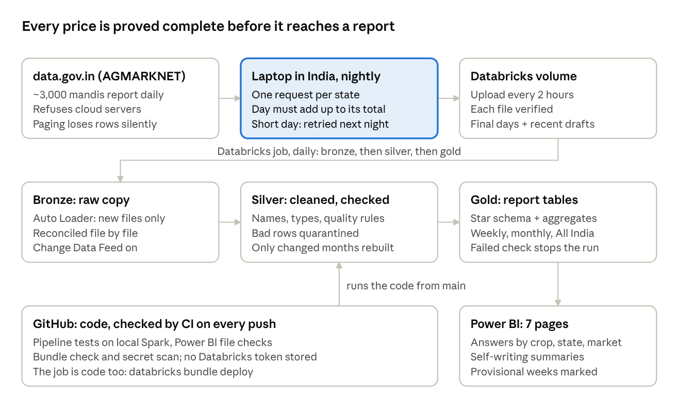

# Mandi Price Intelligence: The Complete Guide

Vikash Mishra · 26 October 2026

A plain-language guide to everything in this project: what was built, why each concept was chosen, the problems solved, and how it would grow in a company. For the technical details, see the [README](../README.md) and the [decision log](decisions.md).

## The project on one page

Mandi Price Intelligence turns India's official daily mandi prices into answers a farmer, trader or analyst can act on, and proves every number is complete and correct.

**The problem.** About 3,000 government wholesale markets (mandis) report crop prices every day on data.gov.in. The data is public but hard to use: messy names, prices stored as text, late uploads, wrong units, and an API that silently loses rows when read page by page. Most sellers only know the price at the one mandi they visit.

**Who it helps.**

- **Farmers and sellers:** which mandi pays the best price for my crop, and how much evidence is behind that price?
- **Traders and buyers:** which states are cheapest, and is today's price normal for the season?
- **Analysts and policy teams:** how are staple prices moving across India, week by week?

**What was built.**

| Part | What it does | Tools |
| --- | --- | --- |
| Extraction | Downloads every day state by state and proves it is complete | Python, laptop scheduler |
| Lakehouse | Bronze (raw copy), silver (cleaned and checked), gold (report tables) | Databricks, Delta Lake, PySpark, SQL |
| Orchestration | One daily job: bronze, then silver, then gold, with alerts | Databricks Jobs |
| Dashboard | Seven pages, each answering one business question | Power BI (PBIP), DAX, Power Query |
| CI/CD | Every code change checked automatically; the job deployed as code | GitHub Actions, Databricks Asset Bundles |

**Results.**

- Over 7 million price rows, every day proved complete before it is used.
- A normal day's run reads 18% of the data a full rebuild does, and gives the identical result.
- Real findings: onion prices tripled in a year; the same crop sold for twice as much in Kerala as in Madhya Pradesh in the same week.

## How it works end to end

A price travels through seven steps, and at each one the system proves nothing was lost before passing it on.

**The journey of one onion price.**

1. **Reported.** A mandi in Kerala reports that onion sold at ₹9,800 a quintal today. It appears on data.gov.in.
2. **Downloaded and proved.** At night the laptop asks for Kerala's prices, then every other state's. The day counts as done only when the states add up to the day's official total. If not, it is retried the next night.
3. **Uploaded.** Every 2 hours, finished days (and fresh versions of recent days) go to a Databricks volume, each file checked after upload.
4. **Bronze.** The daily job loads only the new files, exactly as received, and counts every row in.
5. **Silver.** Names are standardised ("Keralam" becomes Kerala), text becomes numbers and dates, impossible prices are quarantined with a reason, copies are removed, and unusual prices are flagged. Every row is accounted for. Only months that received new data are rebuilt.
6. **Gold.** The price joins a star schema and feeds weekly and monthly medians for Kerala and All India. Checks stop the run if anything doesn't tie out.
7. **Dashboard.** Power BI shows Kerala's market at the top of Market finder for onion, with "reported on 5 of 7 days" beside it.

The code for steps 4 to 6 lives in GitHub. Every change is checked by CI before the next run uses it.

## Concepts used, in plain words

Every concept below solved a real problem in this project; none was added for show.

### Data engineering

| Concept | In plain words | Why it was needed here | Everyday comparison |
| --- | --- | --- | --- |
| **Medallion architecture** (bronze, silver, gold) | Keep data in three stages: raw copy, cleaned, ready for reports | A bad cleaning rule can be fixed and re-run from the untouched raw copy | Raw ingredients, prepped ingredients, plated dish |
| **Completeness proof** | Before a day counts as done, its parts must add up to the official total | The API dropped rows silently while the counts still matched | Counting the cash drawer against the till receipt |
| **Idempotency** | Running a step twice gives the same result as running it once | Jobs retry after failures; a retry must never double the data | Pressing a lift button twice still calls one lift |
| **Reconciliation** | Every row used must be accounted for: clean, quarantined or a removed copy | Proves nothing was lost or invented between stages | A bank statement that balances to the rupee |
| **Quarantine** | Broken rows are set aside with the reason, not deleted | Bad rows can be inspected and fixed; nothing disappears quietly | A returns shelf with a note on each item |
| **Incremental processing** | Rebuild only the months that changed, not all history | Daily work stays small however long the history grows | Re-checking only the pages of a ledger that were edited |
| **Change Data Feed** | Delta keeps a list of which rows changed in each version | Silver asks "what changed since last time?" instead of reading everything | A shop's delivery log instead of a full stock count |
| **Atomic replace** (`replaceWhere`) | Swap a whole month in one transaction | Readers never see a half-written month | Replacing a shelf's stock while the shop is closed |
| **Rules fingerprint** | A hash of the cleaning rules; if it changes, rebuild everything | Old and new months never follow different rules | A recipe version number on every batch |
| **Provisional data** | Recent days are shown but marked as still changing | Mandis keep uploading for up to a month | A draft stamp on a report |
| **Liquid clustering** | Store rows sorted by date so a month's files sit together | Reading one month opens only that month's files | Filing invoices by month in separate folders |
| **Star schema** | One central table of facts linked to lookup tables (market, crop, date) | Fast, simple reports; each name stored once | A sales register with separate customer and product lists |
| **Surrogate keys** (hashed) | Each market or crop gets a fixed number made from its name | The same market gets the same key on every rebuild | A permanent roll number |
| **Aggregates** (weekly, monthly) | Pre-computed summaries for trends | Trend charts read small tables, not millions of rows | Monthly totals at the bottom of a ledger |

### Analytics and reporting

| Concept | In plain words | Why it was needed here |
| --- | --- | --- |
| **Median, not average** | The middle price: half the markets paid more, half less | One market entering prices in the wrong unit cannot drag it |
| **Modal price** | The price most of a crop sold at in a market that day | The most typical price, reported by every mandi |
| **ISO weeks** | Weeks run Monday to Sunday; week 1 holds the year's first Thursday | 29 Dec 2025 belongs to Wk 01 of 2026, so seasons line up across years |
| **Dynamic date table** | The calendar covers only the years the data has | Smaller model; time functions work on whole years |
| **Self-writing summaries** | DAX measures that write a sentence from the current numbers | The headline always matches the data, for any crop picked |
| **Evidence beside a number** | Show how many days a price rests on | A best price from 2 reports is flagged, not trusted blindly |
| **Signs, not colours, for direction** | + rose, − fell; colour only for "check this" | A rise helps sellers and hurts buyers, so colour would imply a judgement |
| **Drillthrough** | Right-click a market to open its detail page, filters carried over | One click from "which market?" to "what did it pay, by variety?" |
| **PBIP** | The report saved as text files instead of one binary file | Every change shows in Git and can be checked automatically |

### Engineering practice

| Concept | In plain words | Why it was needed here |
| --- | --- | --- |
| **CI (continuous integration)** | Every code change is tested automatically on GitHub | Broken code is caught minutes after a push, before it touches data |
| **CD and infrastructure as code** | The Databricks job is defined in a file and deployed by a command | The job can be rebuilt exactly; changes are reviewed, not clicked |
| **Secret management** | Keys and tokens live in local credential stores, never in code | The repository is public; a scanner blocks leaks |
| **Decision log** | Every design choice written down with options and trade-offs | Anyone can see why, not just what |

## Real problems and how they were solved

Each problem below was found by measuring, not guessing, and each fix is now guarded by a check or a test.

| # | Problem | How it was found | Fix | The lesson |
| --- | --- | --- | --- | --- |
| 1 | **The API lost rows silently.** Reading page by page, 94 of 228 days had real rows replaced by copies, yet every day's count still matched | Profiling found duplicates the totals hid | Download one state per request, no paging; a day passes only if the states add up to the day's total and no row repeats | Matching counts are not proof; check content too |
| 2 | **"Duplicates" were a trailing space.** 2,830 rows differed only by a space in the market name | Silver found copies the downloader's byte check missed | Trim names in silver | Clean before comparing |
| 3 | **"Per quintal" was not always per quintal.** Some markets entered prices per bunch or per piece | The same markets were flagged every day; multiplying back revealed the unit | Split one flag into two: unit-suspect series (kept for their own trend) and one-off outliers (left out) | One symptom can hide two causes with different business meanings |
| 4 | **A misspelt state.** 65 to 111 rows a day came under "Uttrakhand" | A diagnostic fetched a whole day once and compared it state by state | Ask for that spelling too; map it to Uttarakhand in silver | Make the check that finds a gap reusable |
| 5 | **Duplicates that are really in the source.** 3 Nov 2025 held 19 identical rows in the API's own answer | Same diagnostic | Accept them only if a single whole-day request has exactly the same rows the same number of times; silver keeps one copy | Prove a rule's exception, don't just relax the rule |
| 6 | **Cloud servers were refused.** data.gov.in blocks requests from cloud computers | Tested from Colab and Databricks: both refused | Download on a laptop in India, upload to Databricks | Test the constraint before designing around it |
| 7 | **A 5.5-hour time shift.** Gold stored a Python time; Spark read it in a different time zone | Local test runs compared timestamps | Keep times as Spark-formatted text | Never mix two systems' clocks |
| 8 | **A setting that only fails on serverless.** `spark.conf.get` of an unknown key is refused on Databricks serverless | The first real job run failed | Read it inside a safe try/except | Local tests prove logic, not the platform |
| 9 | **Week 1 in the wrong year.** 29 Dec 2025 showed as "2025, week 1" on the Seasons chart | Spotted on the chart | Add a week-year column (the year of the week's Thursday) and "Wk 01" labels in Power Query | Pair an ISO week with its ISO year |
| 10 | **Colours that confused.** Green arrows pointing down; one number two colours | User review of the dashboard | + and − signs only; colour kept for "check this" | One colour, one meaning, everywhere |
| 11 | **A "best price" from 2 reports.** ₹10,000 for onion rested on 2 of 7 days | Asked how much evidence sat behind the headline | The sentence now says "reported on 2 of 7 days"; thin evidence is orange in the table | Show the evidence beside the number |
| 12 | **Stale code in the workspace.** A Pull in Databricks hit merge conflicts | The Git folder had old local edits and Windows line endings | Discard local edits; remove the forced Windows line-ending rule | Treat a deployed copy as read-only |

A thirteenth case came from CI itself: on its first run the secret scan flagged the workspace address in two committed files. Both now hold placeholders, the real values stay only on the owner's computer, and the scan blocks them from returning.

## Scenario playbook: what happens when…

The design answers each common data problem with a specific mechanism, so nothing depends on someone noticing.

### What the pipeline handles when data is messy

| Scenario | What the system does | Mechanism |
| --- | --- | --- |
| A mandi uploads prices late (up to a month) | The last 30 days are re-downloaded nightly and shown as provisional; a day turns final when it stops changing | Provisional data, refresh window |
| A day is missing or only half downloaded | It has no "done" marker, so the next run downloads it again | Completeness proof, markers |
| The same report arrives twice | Exact copies are removed in silver and counted | De-duplication, reconciliation |
| The source itself repeats a row | Kept only if proven against a whole-day request; silver keeps one copy | Source-duplicate proof |
| A price is impossible (under ₹1) or a date is broken | The row is quarantined with the reason | Quarantine |
| A market enters prices per bunch or piece | Its series is flagged "another unit" and left out of comparisons | Unit-suspect flag |
| A one-off typo (10 times off normal) | Left out of averages but counted | Outlier flag |
| A new spelling of a state or market appears | The check lists unmapped names; one row added to the mapping fixes it | Alias table, diagnostics |
| The API answers "ok" with no rows | Empty states are asked again, biggest first | Retry of empty answers |
| The source changes its format mid-year | Profiling month by month shows the change; trimming keeps history continuous | Data quality monitoring |

### What the design handles when things go wrong

| Scenario | What the system does | Mechanism |
| --- | --- | --- |
| A cleaning rule changes | The next run rebuilds every month automatically | Rules fingerprint |
| Normal day with new data | Only the changed months are rebuilt | Change Data Feed, month replacement |
| Nothing changed | Silver and gold skip in seconds | Skip logic |
| A task fails halfway | The run stops before gold; email alert; retry once after 5 minutes; a retry can't duplicate | Task dependencies, idempotency |
| Two runs start together | The second one waits in a queue | Job queueing |
| The history grows to many years | Daily work stays the same size; one setting extends the history | Incremental design, clustering |
| The laptop is off one night | The next run fills every gap, however old | Gap filling |
| A code change breaks a rule | CI fails within minutes, before the job runs on data | CI pipeline tests |
| A dashboard edit breaks a visual | CI names the file and the problem | Power BI checks |
| A token is pasted into code by mistake | The secret scan fails the commit | gitleaks |
| The job is deleted or a workspace is rebuilt | `databricks bundle deploy` recreates it from the repository | Asset Bundle |

## Business value

The platform turns a public but unusable dataset into decisions people can trust, and the trust comes from proof, not from promises.

| Who | Decision it supports | Page | Example from the data |
| --- | --- | --- | --- |
| Farmer selling a crop | Where to sell, and whether that price is dependable | Market finder, Market detail | Onion: ₹9,800 at Vadakkenchery, reported on 5 of 7 days, against a middle market of ₹4,280 |
| Trader or buyer | Which state to buy from | Cheapest states | Onion middle price ₹2,833 in Madhya Pradesh against ₹5,800 in Kerala, same week |
| Retail or food company | Is today's price normal, or a spike to plan for? | Seasons | Onion in October 2026 is 190% above October 2025 |
| Analyst or policy team | Which crops are moving most, nationally | Price pulse | Biggest 4-week movers among crops sold in 50+ markets |
| Data team | Can we trust today's numbers? | Data health | Freshness, quarantine rate, reconciliation on every run |

**Why trust is the real product.** A wrong price that looks right costs more than no price: a farmer can hire a truck for it. That is why every day is proved complete, every row is reconciled, recent figures are labelled provisional, and every headline shows its evidence.

**Why the engineering matters to the business.**

- **Lower running cost:** a normal day processes a fraction of the data, so compute bills grow with change, not with history.
- **Faster fixes:** CI catches a broken change in minutes, not after a bad morning report.
- **Less key-person risk:** the job is code, the decisions are written down, and every check is automated.
- **Audit-ready:** each run logs what it read, wrote, removed and why.

## Measured efficiency

A normal day's run read 18% of the rows a full rebuild reads and produced exactly the same tables, measured on 25 Oct 2026 on Databricks serverless.

| Run | Why it ran | Months rebuilt | Silver rows read | Silver time | Gold time |
| --- | --- | --- | --- | --- | --- |
| Full rebuild | A cleaning rule changed (the Uttrakhand spelling) | All | 7,070,715 | 161.2 s | 67.6 s |
| Incremental | 37 newly arrived days | 3 | 1,292,819 (18%) | 85.8 s (53%) | 41.3 s (61%) |
| Skip | Nothing changed | 0 | 0 | about 11 s | about 7 s |

**Why time falls less than rows.** Every run has a fixed cost of about 30 to 40 seconds: reading the change feed, the reconciliation checks, and starting compute. As history grows, a full rebuild keeps getting slower, while a normal day stays about the same, so the saving widens every month.

**How we know the result is identical.** A test runs the real silver and gold notebooks on local Spark: a full build, new data (days turning final, a newer provisional version, an incomplete upload, a backfilled older month), an incremental run, then a fresh full rebuild of the same data. All eight output tables match row for row. CI runs it on every push.

**CI in practice.** On 26 Oct 2026, CI run #3 passed all four checks in 1 min 43 s: pipeline tests 1 min 39 s, Power BI checks 9 s, bundle check 7 s, secret scan 4 s. The first runs failed for two real reasons: the newest Databricks CLI used a pattern style Python could not read (fixed with the `regex` package), and the secret scan found the workspace address in a setup script and in the committed Power BI connection file (both replaced with placeholders).

**What it costs.**

| Item | Cost in this project | In a company |
| --- | --- | --- |
| Databricks | Free Edition, serverless | Paid per compute used; incremental runs keep it small |
| GitHub Actions (CI) | Free (public repository) | Free minutes each month, then a small per-minute charge |
| Power BI | Desktop, free | Pro or Fabric licences to share online |
| Laptop extraction | Free | Would move to a cloud runner with an allowed network |

## Alternatives, and when to choose them

Each choice here fits this project's size and constraints; the table says when a different choice would be better.

| Area | What this project uses | Alternative | Choose the alternative when… |
| --- | --- | --- | --- |
| Extraction | Laptop script on a schedule | Cloud function or Azure Data Factory / Fabric pipeline | The source accepts cloud requests and the pipeline must not depend on one computer |
| Ingestion | Auto Loader (files) | Delta Live Tables / Lakeflow pipelines | You want declared quality rules ("expectations") and automatic lineage with less code |
| Change detection | Change Data Feed + month replacement | Row-level `MERGE` on a business key | Rows have a stable natural key and updates are per row, not per month |
| Change detection | Change Data Feed | Streaming (Structured Streaming) | Data arrives continuously and minutes-old figures matter |
| Late data | Re-pull last 30 days, mark provisional | Slowly changing dimension / bitemporal tables | You must reproduce "what we knew on date X" for audits |
| Storage | Delta Lake on Databricks | Microsoft Fabric lakehouse (OneLake) | The organisation is on Microsoft 365 and wants Power BI Direct Lake without imports |
| Storage | Delta Lake | Snowflake or BigQuery warehouse | The team is SQL-first and wants a fully managed warehouse |
| Modelling | Star schema | One wide flat table | A single report, small data, no reuse across subjects |
| Power BI mode | Import (last 15 months of daily rows + aggregates) | DirectQuery or Direct Lake | Data must be seconds fresh or is too big to import |
| Quality rules | SQL rules + reconciliation in notebooks | Great Expectations, dbt tests, DLT expectations | Many tables and teams need a shared rule library and reports |
| Transformations | PySpark + SQL notebooks | dbt | The team prefers SQL models with built-in tests, docs and lineage |
| Orchestration | Databricks Jobs | Airflow, Azure Data Factory | Pipelines span many systems beyond Databricks |
| CI checks | Local Spark on GitHub | Integration tests on a Databricks test workspace | Serverless-only behaviour must be tested before release (costs compute) |
| Deployment | Bundle deployed from the owner's laptop | Automatic deploy from GitHub with a service principal | A company with dev, test and prod workspaces and approvals |
| Report publishing | Manual publish from Desktop | Power BI deployment pipelines or Fabric Git integration | Shared workspaces on Premium or Fabric capacity |
| Central value | Median | Average, or weighted by arrivals | Volumes are reliable and you need the price per tonne actually traded |

## Improvements: what a company version would add

The foundations are in place; these steps would make it a production platform shared by a team.

| Area | Improvement | What it adds |
| --- | --- | --- |
| Environments | Dev, test and prod workspaces; the bundle deployed to each | Changes are tried safely before they reach real users |
| Code review | Branch protection: CI must pass and a reviewer approves before merging to main | No unreviewed change reaches production |
| Testing | Integration test on a small Databricks test workspace | Catches platform-only issues local Spark can't |
| Extraction | Move the download to a cloud runner on an allowed network | No dependence on one laptop being switched on |
| Governance | Unity Catalog permissions, row-level security in Power BI, data lineage | The right people see the right data; impact of changes is visible |
| Monitoring | Alerts on freshness, quarantine rate and row-count jumps, not only job failure | Silent data problems are flagged the same morning |
| Publishing | Power BI service with scheduled refresh and deployment pipelines | Users open a link; no Desktop needed |
| Insights | Price signals: unusual rises, best nearby mandi, prices below the government's minimum support price | Turns a dashboard into alerts people act on |
| Forecasting | Seasonal price forecasts once several years of history load | Plan purchases and sales ahead of the season |
| Data | Arrival volumes alongside prices | Weighted prices and supply-driven explanations |
| Cost | Compute sizing and run-time budgets per job | Spending stays predictable as data grows |

## Glossary

| Term | Meaning in one line |
| --- | --- |
| AGMARKNET | The government system where mandis report daily prices, published on data.gov.in |
| Asset Bundle | A Databricks project file (`databricks.yml`) that defines jobs as code |
| Auto Loader | Databricks feature that loads only new files, remembering what it has seen |
| Bronze | Raw copy of the data exactly as received |
| Change Data Feed | Delta's record of which rows changed in each table version |
| CI/CD | Automatic checks on every code change, and automatic, repeatable deployment |
| DAX | Power BI's formula language for measures |
| Delta Lake | Table format with transactions, history and time travel on cloud storage |
| Drillthrough | Jump from a row to a detail page with the same filters |
| Gold | Tables shaped for reports: star schema and aggregates |
| Idempotent | Running it twice gives the same result as once |
| ISO week | Monday-to-Sunday week; week 1 holds the year's first Thursday |
| Lakehouse | Data lake storage with warehouse features (tables, transactions, SQL) |
| Mandi | Government-regulated wholesale market where farmers sell crops |
| Median | The middle value: half above, half below |
| Modal price | The price most of a crop sold at in a market that day |
| PBIP | Power BI project saved as text files, friendly to Git |
| Power Query (M) | Power BI's data preparation language |
| Provisional | Recent figures that may still change as reports arrive |
| Quarantine | Holding area for rows that fail quality rules, with the reason |
| Quintal | 100 kg; ₹4,500 a quintal = ₹45 a kg |
| Reconciliation | Proof that every input row is accounted for in the output |
| `replaceWhere` | Delta option that swaps a chosen slice (a month) in one transaction |
| Serverless | Compute that Databricks starts and sizes for you, billed per use |
| Silver | Cleaned, standardised and checked data |
| Star schema | One fact table linked to dimension tables (market, crop, date) |
| TMDL | Text format for a Power BI model's tables, columns and measures |
| Unity Catalog | Databricks' governance layer: catalogs, schemas, tables, permissions |
